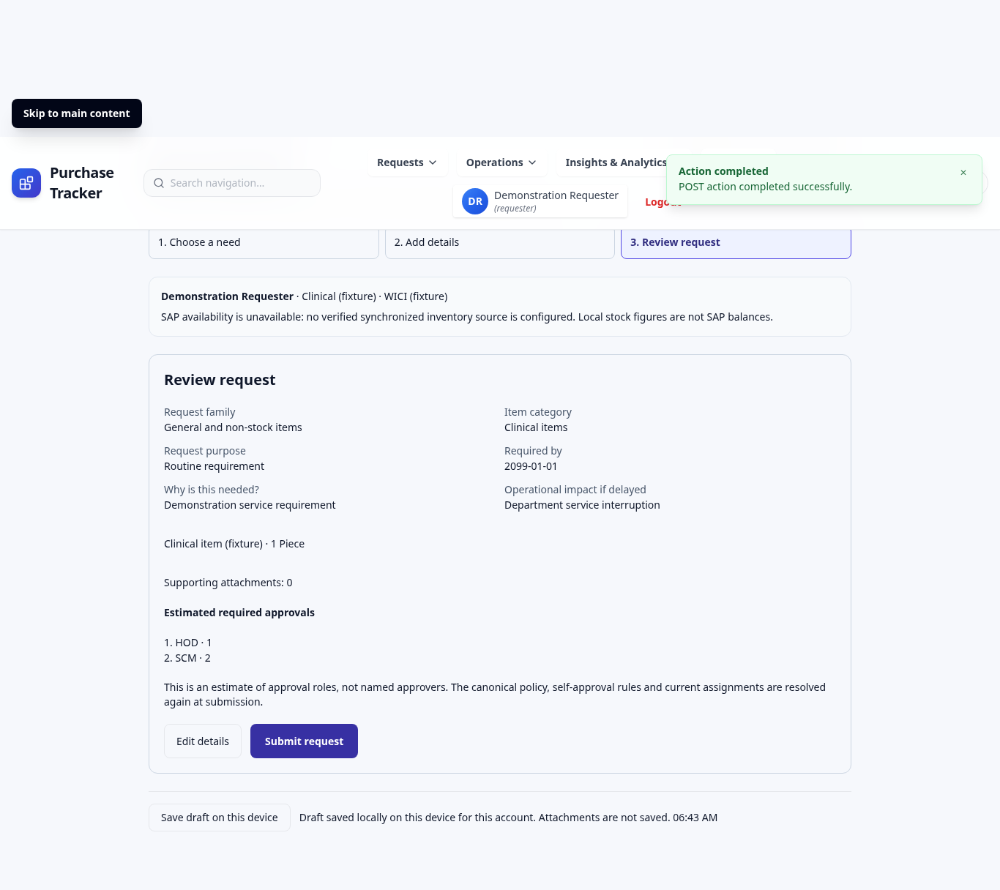
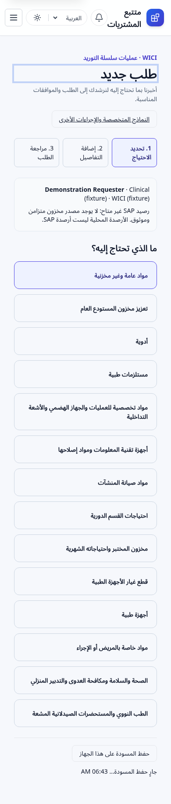

# Guided request submission

## Scope and current authority

This is an opt-in entry guide over the existing `requests` and `requested_items` writer. It does not replace request types, change approval policies, enroll requests into Phase 1 allocations, or post inventory/finance/SAP documents. Reviewed against master `5eff8ccf` and the approved SCOP architecture documents.

The legacy selector exposes many forms and has a medication visibility mismatch: its frontend admits several roles, while `createRequestController` only admits a requester with `can_request_medication`. The guide derives eligibility on the server and preserves that restriction. General canonical request creation is currently authenticated-user based. This change does not invent a create permission, grant a role or weaken existing middleware.

## Family and authorization matrix

All guided operations require authentication, an active database user and a department belonging to the same institute. User, department, section and institute come from current server records. Supplied ownership fields are rejected.

| Guide | Canonical type | Additional fields / restrictions |
| --- | --- | --- |
| General / non-stock | Non-Stock | Active catalog item or controlled Item Master referral |
| General warehouse replenishment | Stock | Assigned, same-institute warehouse; canonical Stock approval/cost semantics |
| Medications | Medication | Existing requester role plus medication entitlement; strength/dosage form |
| Medical supplies | Non-Stock | Canonical item specifications |
| OR / GIT / IR specialty | Non-Stock | Specialty and procedure type; no patient identifiers |
| IT equipment / repair materials | IT Item | Location and equipment compatibility |
| Facility maintenance items | Non-Stock | Location and existing work-order reference |
| Recurring department requirements | Non-Stock | Month and frequency; does not generate recurring orders |
| Laboratory stock / monthly needs | Non-Stock | Analyzer compatibility and requirement month |
| Medical device spare parts | Non-Stock | Equipment model and part number |
| Medical devices | Medical Device | Clinical intended use and installation location |
| Patient / procedure-specific items | Non-Stock | Procedure type/date only |
| OHS / infection control / housekeeping | Non-Stock | Requesting function independent of the department |
| Nuclear supplies / radiopharmaceuticals | Non-Stock | Isotope, activity/unit, calibration time, existing authorization reference |

Medication, medical-device and IT catalog types cannot be routed through another family. Medication and device families also require the matching catalog/referral type. These mappings retain existing types; they do not establish new clinical or regulatory approval authority. Have clinical, laboratory and radiation-safety owners review their existing Non-Stock policies before enabling the flag. Maintenance materials are distinct from the technician-only legacy Maintenance work-order request; that specialized form stays available.

Covered Stock items explicitly hand off to the existing `/requests/stock` form, which retains the established contracted-item chooser. The server blocks guided Stock submission for active matching contracts; it does not silently bypass the legacy form requirement.

Model/part/work-order/analyzer references in specifications are supporting descriptions, not verified foreign keys or authorization to mutate those records. No additional equipment, work-order or patient-record read permissions are granted.

## Data and transaction ownership

- Canonical active `generic_items` are searched with own-institute/shared scope. Only a short item-identity projection is returned; supplier pricing, financial values and stock balances are omitted. The restricted guide catalog endpoint does not grant general Item Master administration/view access.
- `item_categories` and Phase 1 `scop_request_purposes` provide existing category/purpose vocabularies. Each request has one family/category; mixed categories require separate requests. Item catalog category must match the selected category.
- Uncatalogued lines use existing `pending_item_creation`. The canonical writer creates `pending_item_requests` and item-identity audit evidence. It does not create or activate a master item. Existing procurement-readiness controls continue to apply.
- Existing `requested_items.required_date`, `intended_use`, UOM and quantity hold their canonical values. Human-readable `WICI guided submission v1` specifications preserve family, category, purpose, impact and specialized details. This deliberately avoids new metadata tables or automatic conversion into an approved SCOP requirement profile. This context is descriptive, not an immutable typed lifecycle or authoritative work-order/asset link; existing controlled item-edit behavior remains applicable.
- The guide validates and translates into `createRequestController`. The canonical request transaction owns approvals, item identity, attachment persistence, required audit and notification outbox. After `BEGIN`, it locks and revalidates requester/department, warehouse and selected catalog items. Changes to ownership, context or catalog identity require review again. Concurrent deactivation is blocked until transaction completion.
- Existing `client_submission_key` uniqueness provides retry/concurrent duplicate protection. A key identifies one submitted command; clients must not reuse it for a different request. The existing legacy writer returns the original result for a reused key rather than performing a new submission.
- The preview uses `fetchApprovalRoutes` with the same type, department domain and cost semantics, including the established SCM fallback. It reports roles/levels as estimates; final approvers, self-approval and routing are resolved by the canonical writer. If the canonical writer produces an unassigned approval role, the guide rejects and rolls back rather than treating the missing person as approval. This contains a discovered legacy auto-approval fallback without rewriting the resolver or changing legacy routes. No Approval Engine V2 or live routing activation occurs.

## API contracts

All paths below are under `/api/requests/guided`. Authentication and the server flag are required. Disabled service returns 404.

| Method/path | Contract |
| --- | --- |
| GET `/options` | Server-derived requester; supported families and eligibility; active categories/purposes; actual attachment limits; SAP availability state |
| GET `/catalog?q=...` | At most 10 active shared/own-institute Generic Items; search length capped at 160 |
| POST `/preview` | JSON guided payload; validates every item and specialized field; returns canonical request type, estimated cost, approval roles/levels, fallback and pending-review indicators |
| POST `/` | Multipart `payload` containing the same JSON plus repeated `attachments`; canonical 201 response, or existing 200 duplicate-command response |

Example general payload:

```json
{
  "family": "general",
  "category_id": 12,
  "purpose": "ROUTINE",
  "required_by": "2099-01-01",
  "justification": "Approved departmental operational need",
  "operational_impact": "Service interruption if delayed",
  "specialized": {},
  "items": [{ "request_mode": "generic_item", "generic_item_id": 123, "quantity": 2, "unit_cost": 0 }],
  "client_submission_key": "unique-per-request-command-key"
}
```

Catalog identity/name/UOM are re-derived, not trusted from the browser. Quantity is a positive safe whole number, costs are nonnegative safe whole numbers in the existing USD estimate convention, and totals are range checked. Dates must be valid, today or later. There are 1–50 items. Pending referrals additionally need proposed name, supported item type, matching category, UOM and justification. The server rejects undocumented fields and patient identifier keys. Free text and attachments cannot be guaranteed PHI-free by a field allowlist; the interface warns users and offers no patient-ID fields. Existing attachment type/size/count/storage controls apply.

## UI descriptions

At `/` or `/requests/new`, the enabled guide presents three keyboard-accessible stages:

1. A responsive two-column family choice, with server-ineligible options disabled and an explanatory message.
2. Read-only requester/institute/department context; separate category and purpose; required date; conditional fields; reused canonical catalog/referral selector; repeatable quantity/UOM/specification rows; justification, impact and attachments.
3. A review showing the entered operational summary, item quantities, attachment count and estimated approval roles. Editing invalidates the preview; submission uses the canonical confirmation screen.

The layout collapses on mobile, focuses the main heading on step changes, uses labels, focus states and alert/status regions, and follows existing Tailwind light/dark styling. English/Arabic keys share the existing i18next namespaces and RTL direction. Master-data names remain in their stored language.

Drafts use the existing local autosave hook, with an explicit Save action and a canceled pending timer after successful submission. Storage keys include institute and user. Another account/institute does not restore the draft. Browser files are never persisted and require reattachment after reload. These are device-local drafts, not shared/server workflow records; shared workstations and user-entered sensitive free text still require operational privacy controls.

SAP availability always reports unavailable because no verified synchronization provider exists in this repository. Local warehouse stock is never relabeled SAP inventory. Before a later integration displays SAP quantities, it must provide trusted company/warehouse/item identity, synchronization timestamp and a reviewed stale-data policy.

## Rollout and recovery

No database migration required. Existing schema contract `hospital-erp-2026-11-scop1` and its prerequisites through 072 must already be deployed and verified. No historical records, frozen SQL or schema-contract definition are changed. The locked application-source manifest changes because backend source changed: the authorized release operator must bind/verify the approved new application digest using the existing release-governance process. Do not reuse a previous release attestation or bypass startup verification.

1. Pass code, schema, security and guided PostgreSQL CI checks. Obtain clinical/regulatory acceptance for the family mappings and review current approval policies.
2. Keep `GUIDED_REQUESTS_ENABLED=false` and `REACT_APP_GUIDED_REQUESTS_ENABLED=false` by default. Deploy only through the established manually approved release process after full database compatibility verification.
3. On an approved Development pilot, set server `GUIDED_REQUESTS_ENABLED=true`, and build the frontend with `REACT_APP_GUIDED_REQUESTS_ENABLED=true`. Both are required. No flag grants privileges. Keep `LIVE_ROUTING_ENABLED=false` and V2 disabled.
4. Validate all families, Arabic/mobile, active catalog search, pending-item referrals, drafts, attachments, preview/final route, institute isolation and confirmation IDs with controlled fixtures. Obtain explicit operational acceptance before Production enablement.
5. `/requests/legacy` and every existing specialized route remain available. If the server flag is off, the new entry falls back to the legacy selector. On rollback, disable the server flag and return to the compatible legacy frontend; retain submitted canonical records and audit history. Do not delete data or reverse financial/inventory transactions.

A 502 during startup is not fixed by enabling this feature: resolve the deployed release's database contract failure first. An offline `db:plan` lists the active delta, not all missing prerequisites or proof of hosted readiness.

## Validation

The `guided-requests` release gate uses the governed disposable PostgreSQL runner through 072, actual authentication, guide routes and canonical writer. It exercises every family, stored item details, current approval policy, audit/outbox, foreign institute/catalog/warehouse denial, medication eligibility, invalid quantities/PHI keys, pending referrals, concurrent duplicate commands, audit rollback and deactivation. Unit/component regressions cover family-specific fields, draft scoping, disabled flags, server errors, input validation and canonical confirmation navigation. Existing full backend/frontend suites, strict lint, localization parity and production build remain required. See the PR for executed results.

No hosted SQL execution, deployment, merge, historical conversion or SAP posting is performed by this implementation.

## Fixture UI evidence

Local Chromium/Playwright checks exercised family choice, catalog selection, review, a 390px mobile viewport with no horizontal overflow, and Arabic RTL. All API responses were intercepted local fixtures; no live login, requests or patient records were used. Five screenshots were captured; representative views are included here.




