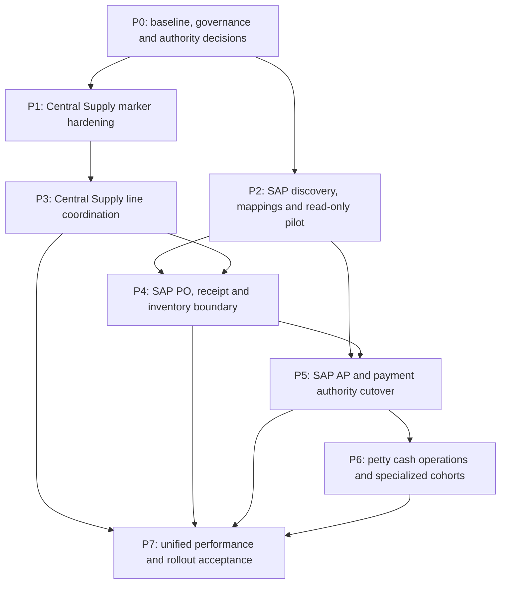

# SCOP implementation roadmap and file-level plan

**Documentation baseline:** `e72bf67d`, 2026-11-06. This PR implements none of the proposed modules or flags. Read [current state](scop-current-state-audit.md), [operating model](scop-target-operating-model.md) and [transaction ownership](scop-transaction-ownership.md) first.

## Dependency map

P3 may deliver controlled center coordination without SAP API access, but must retain existing local posting behavior and make no claim of SAP stock/financial authority. Read-only reporting can evolve incrementally; final unified acceptance depends on authoritative inputs. Estimate phases after SAP/center discovery and data-quality sampling, not from repository file counts.

## P0 — Baseline and policy decisions

**Owners:** SCM, Finance, Warehouse, Biomedical/technical review, Master Data, Security and IT release owner.

- Approve the transaction matrix, center-first category exceptions, local residual authority, data retention/PHI policy, SAP company/institute/warehouse mapping and field stewardship.
- Verify deployed application commit/schema/worker versions using the existing manual release process. Inventory live in-flight PRs/POs/receipts/contracts/AP/payments, opening balances and local master creation paths without modifying records.
- Establish SAP connectivity/API/license and center exchange capability. Do not assume real-time APIs: an authorized signed/manual response or controlled extract is an initial option, with provenance and freshness visible.
- Decide SAP PO issuance, GRPO/quarantine/disposition, service/non-PO, consignment, transfer, tax/UOM/currency and correction semantics. Obtain API sandbox and finance-approved fixture scenarios before enabling writes.

**Files:** extend architecture/decision documentation; reuse `purchase-backend/scripts/databaseRelease.js`, release contracts/inventory, `docs/releases/quality-gates-7d.md` and `scripts/quality/gates.json`. No business schema changes are necessary for discovery.

**Exit criteria:** named owners sign the authority and category matrix; deployment drift and unknowns are recorded; no ambiguity over which system may post each pilot transaction; baseline recovery and reconciliation procedures are demonstrated. An unavailable SAP sandbox blocks write-integration phases, not documentation or bounded existing-route hardening.

## P1 — Recommended first implementation PR

**Proposed PR:** “Harden Central Supply tracking scope and transactional audit.” This is a bounded prerequisite to richer coordination; it does not introduce center outcomes or SAP integration.

Current `centralSupplyChainController` authorizes `requests.manage` but lets a null actor institute broaden a query and treats audit/log failure as optional. Keep the boolean API, response shape, timestamps and UI behavior while removing ambiguous authorization and required-audit failure modes. Preserve any explicitly documented server-side cross-institute authority; this route currently must not infer one from null scope.

| Existing file | Proposed change |
|---|---|
| `purchase-backend/controllers/requests/centralSupplyChainController.js` | Fresh server-derived capability and institute validation, existing row lock, fail-closed object scope, mandatory authoritative audit within transaction, meaningful before/after evidence; distinguish no-op retries from new transition. Retain compatible request log behavior without making it the audit authority. |
| `purchase-backend/routes/requests.js` | Reuse existing permission middleware where appropriate; keep PATCH `/:id/central-supply-status` contract and route ordering. No new bypass endpoint. |
| `purchase-backend/services/auditService.js` | Reuse existing transactional writer; change only if a demonstrated API gap exists. Do not globally reclassify optional telemetry. |
| `purchase-backend/__tests__/centralSupplyChainController.test.js` | Add missing/foreign institute, inactive/unauthorized actor, audit rollback, duplicate retry and concurrency cases in addition to compatibility assertions. |
| `purchase-backend/integration/` and current disposable test runner | Add real PostgreSQL scope/locking/rollback coverage to an appropriate existing profile; register with quality gates if a separate profile is genuinely needed. |
| `purchase-frontend/src/pages/AllRequestsPage.test.jsx` | Confirm existing sent/not-sent action/filter and permission visibility remain compatible. Change page logic only if the revised error contract requires it. |

**Acceptance:** no foreign request disclosure/update; null institute fails closed; capability revalidation is server-side; required audit failure rolls back marker mutation; concurrent/duplicate commands yield one effective transition and appropriate audit; setting/clearing the marker never changes approval, ownership, priority, PO, stock, AP or payment. Existing authorized same-institute behavior and filters still pass. No notification is added without a business requirement. Reuse current state/no-op handling for idempotence where sufficient; add command identity only if tests prove a need. No migration expected unless inspection proves a durable-key requirement.

## P2 — SAP identity and read-only observation

**Depends on:** P0 approved SAP access and stewardship policy. SAP writes remain disabled.

- Inventory current generic/product/catalog, stock and supplier/warehouse mappings; reconcile reviewed candidates to company-scoped SAP keys. Reject ambiguous name/amount/UOM matching.
- Import authorized masters/document statuses as source-attributed projections. Preserve local PKs, historical names and clinical restrictions; display source/freshness and unresolved mappings.
- Introduce narrowly scoped read-only adapter, import checkpoint/deduplication and authorized reconciliation visibility. A supporting external-key registry is permissible only after confirming existing internal mapping/document-flow structures cannot represent company/object/key semantics safely.

**File-level plan:** extend `services/itemMasterFoundationService.js`, `supplierReferenceService.js` callers, `controllers/suppliersController.js`, item-master and stock-item-request routes, warehouse reference readers and current master stewardship UI. Proposed new `purchase-backend/services/sap/` adapter/mapping/readback modules and corresponding tests are integration infrastructure, not replacement masters. Register configuration through existing validated startup/release conventions; never commit credentials. Extend `document_flow_links` handling only after relationship design. Any additive mapping/checkpoint migration needs the governance process below.

**Acceptance:** same SAP key in two companies cannot collide; foreign institute/warehouse mappings fail; mapping revisions retain history; duplicate extracts are harmless; inactive/deleted master status is handled explicitly; WICI clinical fields survive refresh; stale imports are labelled. No local finance/stock values or SAP records change. Read-only pilot reconciles a signed sample including multi-UOM/lot/serial/expiry and shared supplier cases.

## P3 — Line-level Central Supply and local residual authorization

**Depends on:** P1 and approved P0 policies. P2 is required before using SAP identities in outbound transactions, but not for manual center evidence tracking.

- Add center submission/response references, versioned source allocations and reviewed local residual authority linked to existing request/item IDs. Preserve historical unknowns and the existing marker API as a compatibility summary, never as financial evidence.
- Extend existing request workspace and buyer/department boards with center response, committed/outstanding quantities, authorized residual, evidence and next action. Reuse attachment, permissions, audit and notification infrastructure.
- Use current request/PO/award/consignment routes for local execution. Prevent active source portions exceeding approved demand under concurrent center/local revisions. Do not invent an approval engine or change assignment workload policies.

**File-level plan:** `controllers/requests/centralSupplyChainController.js`, `routes/requests.js`, `services/procurementAssignmentService.js` integration points without changing its policies, `services/procurementReportingService.js`; proposed focused `services/centralSupplyCoordinationService.js` and repository if existing services cannot house the new responsibility. Frontend `RequestDetailWorkspace.jsx`, `AllRequestsPage.jsx`, `DepartmentRequestedItemsBoard.jsx`, existing API consumers and locale catalogs. Add supporting line-response/allocation schema only after checking existing case/activity/document coverage; no duplicate request/PO/GR tables. Update quality policy tests and disposable concurrency coverage.

**Acceptance:** center accepts/partially commits/delays/declines/revises with evidence; local residual requires authorized review; 10-unit split example in the operating model holds; cancellation/replacement preserves quantities/history; concurrent local PO and center revision cannot overlap; no stock/AP posting from a center promise; historical marker remains readable; unauthorized users cannot submit/release allocations. Clinical categories use approved routing profiles and server-derived institute scope.

## P4 — SAP PO, receipt and inventory authority pilot

**Depends on:** P2 mappings/sandbox and P3 source-allocation controls for center cohorts. Begin with one approved company/institute/warehouse pool and a small mapped item cohort; avoid split authority within a physical pool.

- Introduce approved posting intent/acknowledgment at existing service boundaries. Decide supplier-facing issuance timing with SCM/Finance before changing PO behavior.
- Preserve AUD-009 award/PO technical gates and AUD-008 isolation. Preserve receipt, acceptance, quarantine/rejection and issue/fulfillment distinctions from SQL 067/068.
- Reconcile opening stock, pending receipts/issues/transfers/reservations and in-flight documents. Switch the affected writer once; do not mirror imported SAP movements as fresh local stock postings.
- Use durable leased commands, stable operation keys, deduplicated inbox application, unknown-outcome recovery and authorized exception monitoring. Do not reuse notification payload storage as an unspecified financial command bus.

**File-level plan:** `services/purchaseOrderService.js`, `procurementAwardService.js`, `goodsReceiptService.js`, `goodsReceiptInventoryAdapter.js`, `deliveryInspectionService.js`, `inventoryPostingService.js`, `inventoryStatusTransferService.js`, `inventoryReservationService.js`, `inventoryReversalService.js`, `warehouseTransferService.js`, `controllers/warehouseSupplyController.js`; `procurementCompletionService.js` and canonical read models. Proposed `services/sap/` posting coordinator and durable command/inbox/reconciliation support. Reuse P2P lifecycle/PO/receipt/warehouse pages. A new worker must be registered in startup, release manifest and monitoring with its schema/protocol requirements.

Do not edit SQL 067/068 in place. If completion functions need SAP evidence, supply reviewed forward replacements in a new migration while preserving signatures or explicitly supporting versioned callers.

**Acceptance:** valid same-institute PO/GR/inspection/issue works; pending/rejected/quarantined units remain unavailable; multiple PO/GR/partial/replacement deliveries aggregate once; accepted warehouse delivery does not imply departmental receipt. Test crash before dispatch, after SAP commit/before acknowledgment, DB interruption, concurrent worker, duplicate/stale acknowledgment, revocation, foreign warehouse, unknown outcome and audit failure. Require current P2P, inspection, inventory, completion and RFID regression suites plus sandbox contract tests. No blind timeout reposting and no fallback to local posting.

## P5 — SAP AP/payment authority and historical close-out

**Depends on:** P2 and P4 source-document lineage; Finance-approved opening liabilities, allocations, periods and cutover scope. Existing local canonical financial paths remain for pinned pre-cutover records only under documented close-out rules.

- Keep invoice capture, matching, exception review and vouchers operational. SAP creates posted liability, accounting and payment allocation facts for the enabled cohort.
- Evolve projections to distinguish local historical postings, SAP pending, SAP confirmed and unknown/reconciliation-required states. Never relabel old `posted_at` or paid amounts as SAP evidence.
- Use historical reconciliation worklists to link supported relationships and identify potential duplicate settlement exposure; no auto-creation/reversal/backfill. Currency totals and incomplete mapping coverage remain explicit.
- Gate all local posting entry points for SAP-owned scope, including indirect contract and helper paths; a screen-only disabled button is insufficient.

**File-level plan:** `services/apPostingService.js`, `paymentService.js`, `invoiceMatchingService.js`, `p2pAuthorization.js`, `contractFinanceIntegrationService.js`, `contractFinancialProjectionService.js`, `contractFinancialReconciliationService.js`, `legacyContractSettlementPolicy.js`, `routes/procureToPay.js`, `routes/contracts.js`, document-flow repository; existing AP/invoice/payment/contract pages. Add SAP adapter mapping/acknowledgment and source-attributed projections, not duplicate AP/payment business tables. Preserve already-contained legacy writers and existing canonical constraints; extend additive contracts only after field semantics are reviewed.

**Acceptance:** approved invoice maps to one SAP AP document; partial/multiple payments and reversals reconcile correctly; duplicate settlement blocked across source epochs; same amount/different supplier/invoice/currency never auto-matches; unknown SAP outcome blocks repeat posting; historical rows unchanged; audit failure rolls back local intent; imported settlement cannot call `postPayment` as a new payment. Run all financial, contract lifecycle, historical reconciliation, authorization and event reliability profiles. Finance signs reconciled opening/closing totals before activation.

## P6 — Operational petty cash and specialized cohorts

**Depends on:** P5 for petty cash financial linkage; P0/P2/P4 and clinical governance for specialized procurement cohorts. These can be split into smaller domain PRs.

- Implement only approved petty cash operational gaps: voucher/custody/evidence/liquidation and SAP status, without a cash accounting or settlement engine.
- Extend existing surgical consignment, devices, spare parts, maintenance, recall and recurring planning capabilities after domain gap validation. Do not duplicate specialty case tables or treat monthly dispensing as medication administration.
- Add required controlled classification and technical profiles for OHS/infection control/housekeeping/nuclear medicine. Clinical/regulatory approval, patient-data minimization and authority boundaries precede release.

**File-level plan:** reuse existing `routes/surgicalConsignments.js`, `services/deviceDemoService.js`, equipment/maintenance/spare-parts/recall/planning modules and relevant pages. Proposed petty cash route/service/page is a new operational capability only if schema inventory confirms no equivalent workflow; reuse attachments, contract/invoice links, capability policies and SAP references. Confirm exact target files in each bounded implementation PR rather than creating placeholder modules now.

**Acceptance:** no category bypasses approvals/technical review; patient-specific evidence stays scoped; consignment returns/consumption remain traceable; petty cash authorization cannot independently post cash/payments; settlement/return exceptions are reviewed; existing device-demo Medical Device-only gate and specialty regression tests remain green.

## P7 — Reporting and cohort expansion

Extend `services/procurementReportingService.js`, `services/procurementCompletionService.js`, procurement performance/priority modules, `SupplyChainPerformancePage.jsx`, `DepartmentRequestedItemsBoard.jsx` and existing contract financial projection. Use existing report/export authorization and shared source maps.

**Acceptance:** reports separate demand, commitments, ordered, physical received, accepted, usable, department fulfilled and settled; show source/epoch/freshness/coverage; no foreign-institute or competitor leakage via search/export/attachments. Center delays, local exception age, rejected replacement and SAP unknown outcomes are visible. Totals remain currency-specific. Reconcile report samples to original evidence and run completion-reporting/frontend/localization regressions before expanding each cohort.

## Existing migration dependency anchors

This is a relationship map for planning, **not a SQL execution list**. The release verifier must check actual contracts and execution receipts rather than infer readiness from filenames.

| Existing anchor | Dependencies / significance for implementation |
|---|---|
| 059 canonical schema | Broad populated baseline for current P2P, identity and inventory. Do not replay it to repair one missing object. |
| 064 → 065 → 066 | Contract authorization scope precedes canonical finance provenance, then historical reconciliation; 065/066 also require their stated 059 contracts. Preserve contained legacy writers. |
| 059 → 067 → 068 | Completion projection then receipt/status-transfer provenance. Future SAP evidence must preserve function contracts and historical quantities. |
| 069 → 070 → 071 | Governed database release receipts/contracts, RFID recovery, then transactional event reliability. The governed bundle and actual source/grant prerequisites are required, not just numeric order. |
| Current application contract and source manifest | `hospital-erp-2026-11-7c` and locked runtime sources must match the reviewed build. A future backend edit may require updating the application manifest under the existing release process even without new SQL. |

Migration versions, checksums, permission/RLS/function requirements and worker protocols must be reviewed together in each implementation PR. Source digests are not updated in this documentation-only change.

## Proposed rollout controls

These control names describe a design; **they do not currently exist**. Implementation must use server-enforced reviewed configuration with institute/company/domain scope, audited changes and explicit defaults. Frontend visibility is not the security boundary.

| Proposed control | Initial behavior | Activation requirement |
|---|---|---|
| Central Supply coordination | Off; existing marker behavior remains | P1 hardened, P3 tests and SCM source-allocation policy signed |
| SAP master observation | Off; current masters remain active | P2 mapping/read-only permission and stewardship approval |
| SAP command shadow validation | Off; never dispatches | Mappings, policy, sandbox contract and safe payload review |
| SAP PO/inventory authority | Off; no new SAP writer | P4 opening stock/in-flight reconciliation and scoped authority switch |
| SAP finance authority | Off; no new SAP posting/payment route | P5 Finance acceptance and local-writer fencing |
| Petty cash operations | Off | P6 approved policy, finance linkage and segregation tests |
| Specialized category profiles | Off per new profile | Relevant domain owner approval and regression coverage |
| Unified SAP-aware reports | Off or shadow comparison | Validated projections, freshness and report access policy |

Pin authority to operation/document and effective epoch. Reading a flag at each retry without pinning it can change ownership mid-flight. When paused, allow only authorized recovery/reconciliation and reads. `LIVE_ROUTING_ENABLED=false` remains unchanged; none of these controls activates Approval Engine V2.

## Migration and historical preservation strategy

1. **Inventory and classify first.** Record deployed contract, existing tables/constraints/RLS/grants, populated edge cases, local/SAP IDs and orphan or inconsistent references. Obtain approved read-only extracts and hashes; no production credentials in docs/artifacts.
2. **Expand only where needed.** Prefer existing canonical tables plus additive provenance/mapping/intent/history support. Use the then-current next migration number from release tooling, not a number reserved by this document. Do not modify frozen migrations, replay historical migration collections, rename/drop tables or reset sequences.
3. **Review each patch manually.** Include preflight ownership/duplicate/null/UOM/currency checks, short lock/statement timeouts, supporting indexes/uniqueness and least-privilege grants, populated compatibility and postflight verification. Run disposable PostgreSQL tests including old populated data and audit rollback. Update locked inventory/schema contracts through existing governance; application, schema and workers must agree.
4. **Separate mapping from financial mutation.** A reviewed identity/link backfill may be a later explicitly approved operation with scope, dry-run evidence, batch/checkpoint and immutable review history. This task authorizes no backfill. Never infer technical acceptance, change paid amounts or fabricate audit from incomplete history.
5. **Pin historical authority.** Preserve legacy contract invoices/payments and current local canonical finance/stock evidence. Mark origin/coverage; do not merge/import SAP transactions by overwriting these rows. Decide whether in-flight documents close locally, migrate with approved opening documents, or are individually reconciled. Never post both versions.
6. **Cut over only reconciled scope.** Backup and verify recovery, apply approved additive SQL manually, verify contract, deploy compatible inactive code/workers, run sandbox/fixture smoke checks, then approve a scoped authority change. CI is readiness, not deployment authorization.
7. **Rollback by containment.** Stop new dispatch for affected scope, retain pending/unknown intents and evidence, reconcile SAP outcomes, then use approved compensating documents in the owning system. Rolling back application code requires compatibility with the expanded schema. Turning a flag off must not reactivate local settlement for already SAP-owned documents. Never delete ledger/audit history or restore a stale database over acknowledged SAP postings.

No migration is required for this documentation PR. Future migrations and source/contract digest changes must be independently reviewed under existing 7A/7D governance. No hosted SQL is executed by this plan.

## Release and acceptance gates

Use the existing 23-gate release policy and disposable PostgreSQL profiles; do not bypass failures to make new integration tests green. Each behavioral PR must run applicable backend unit/syntax/auth tests, frontend tests/production build/localization, schema/function/RLS/grant/permission checks, populated migration compatibility and affected PostgreSQL suites. P2P, contracts, completion 067/068, RFID 070 and audit/outbox 071 remain protected. Add SAP sandbox contract tests with no production endpoints; ordinary CI must never inherit hosted database/SAP credentials.

Safe live smoke tests are read-only unless a separately authorized fixture exercise exists. Verify authentication, scoped request/approval/assignment views, RFx/PO provenance, GR/technical/warehouse progress, contract/invoice/AP/payment references, RFID health, audit/outbox status and reporting freshness. Obtain operational acceptance after monitoring pending/unknown/error queues. Manifest must include application SHA, contract/migration checksums, test/build results and required worker protocols, including any new integration worker.

## Risks and unresolved decisions

| Risk / unknown | Release consequence / mitigation |
|---|---|
| SAP API, licenses, company setup or approved write objects unavailable | Blocks write phases; preserve truthful local workflows and read-only/manual evidence options. |
| Unreconciled masters/UOM/lots/serials/currencies or mixed warehouse authority | Blocks affected postings/cohort activation; review mappings and opening balances. |
| Center cannot supply structured responses or cancellation acknowledgment | Require attested evidence and manual reviewed residual; never assume silence is release. |
| In-flight local/SAP documents or ambiguous external commit | Freeze duplicate execution; explicit reference search and Finance/Warehouse reconciliation. |
| Existing fallback master creation/name stock lookup bypasses target authority | Audit all callers; fence SAP-owned fields/writers server-side after approved mapping. |
| Receipt/inspection/SAP stock state drift | No usable stock from local acceptance alone; reconcile signed decision and posted disposition. |
| Historical gaps or legacy settlement duplicates | Preserve unknowns and potential exposure labels; authorized evidence-based review, no automatic losses/backfill. |
| Category routing, segregation, clinical/regulatory policy not signed | Keep new profile off; use existing approved routes. |
| Integration outage/revoked user/stale recipient scope | Durable leases and scoped revalidation; fail closed for posting, visible operations queue. |
| CI passes but live schema/worker drift remains | Operator verifies contract and worker versions; no automatic production acceptance. |

## Documentation PR verification and scope

Changed files are exactly the four SCOP documents in this directory. Read-only checks: database/source contract and required permission inventory; localization parity; offline database release plan; relative-file links; whitespace/diff review. Results and limits are in the [audit](scop-current-state-audit.md#read-only-checks-for-this-documentation-pr).

No application, SQL, schema contract, credentials, feature flags or worker configuration is changed. No hosted query, deployment, migration or merge is authorized by this documentation PR. The focused draft PR is for architecture review; P1 is the recommended next separately tested implementation PR.
