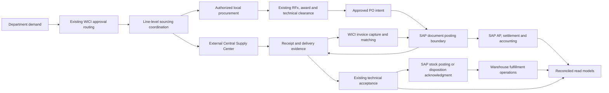

# SCOP target operating model

**Status:** proposed implementation blueprint based on `e72bf67d`, 2026-11-06. SAP authority is the business requirement; integration and deployment are not established by this document. See the [current-state audit](scop-current-state-audit.md), [ownership matrix](scop-transaction-ownership.md) and [roadmap](scop-implementation-roadmap.md).

## Operating boundary

WICI SCOP is the primary operational interface for departmental demand, approval, sourcing execution, Central Supply coordination, technical acceptance, fulfillment tracking, invoice evidence and supply chain performance. SAP Business One on HANA owns item/supplier masters, warehouses, posted inventory and valuation, AP, payments and accounting. An operational screen may initiate a governed request to SAP or display a SAP result; that does not give it an independent posting authority.

Retain the existing Express modular monolith, React application, request IDs, item IDs, canonical P2P/inventory services, audit/outbox patterns and institute authorization. Add focused adapters and operational state where a verified gap exists. Do not replace the application with generic workflow tables, another approval engine or a second inventory/financial ledger.

Arrows represent evidence/dependencies, not an unapproved SAP API contract. In particular, whether SAP GRPO initially posts quarantine stock, and whether accepted stock is a subsequent SAP disposition/warehouse transfer, requires approved warehouse and accounting configuration. WICI must not mark accepted stock available simply because a local inspection decision exists.

## Demand classification and routing

Keep existing request types and route snapshots. Add or reuse controlled classification dimensions only after inspecting actual category/reference coverage: clinical category, source channel, recurring plan, urgency, patient-specific restriction, stock policy and technical-review profile. Display labels must not change API enum values or reclassify historical approvals.

| Demand cohort | Operational treatment | Reuse and policy boundary |
|---|---|---|
| Medication, medical supplies, laboratory supplies | Normally route approved demand to Central Supply; track response, commitment, schedule and residual | Existing Medication/Stock/Non-Stock forms as appropriate, item identities and approval engine. Center-first policy needs versioned exceptions; it is not an unconditional block on emergency local procurement. |
| General items, IT, facility maintenance, housekeeping | Warehouse availability, replenishment or local sourcing according to approved category rules | Existing requests, maintenance, warehouse supply, procurement plans and RFx. No separate approval engine per department. |
| Recurring requirements | Planning produces demand proposals and scheduled requests; approved budget/route still applies | Existing procurement plans, MRP and replenishment policies; forecasts do not issue POs. |
| Medical devices and spare parts | Maintain clinical/product specificity, trials, technical clearance, equipment/custody linkage | Medical Device-only demo eligibility, pre-procurement review, delivery inspection, equipment/spare-parts modules. A biomedical reviewer is not automatically an award or payment approver. |
| Specialty surgical and patient-specific items | Preserve case/consignment evidence, authorized vendor supply/return and consumption/billing references | Surgical consignment and existing restricted product policies. Minimize patient data; define authorized HIS references rather than copying PHI into SAP sync payloads. |
| OHS, infection control, nuclear medicine | Controlled classifications and approved technical/regulatory profiles | Department governance and existing request/inspection patterns. Nuclear procurement/transport/storage/expiry or decay rules require specialist approval; do not infer them from generic stock behavior. |

Stakeholders must approve the category-to-route/channel matrix before behavior changes. Existing institution-specific authority and explicit cross-institute exceptions take precedence over UI filters. Central Supply is an external partner, not automatically a WICI institute or warehouse.

## Central Supply coordination

Model a durable relationship between an approved request line, center submission/reference, response revisions, center commitment quantities and evidence. Reuse request/item/document/audit infrastructure. Add supporting records only where the current schema lacks equivalent semantics; do not create another request, PO or receipt table merely to attach a center reference.

A request can have multiple submissions/deliveries and split sourcing. Center statuses describe its response: submitted, acknowledged, partly/fully committed, delayed, declined, revised or cancelled. These are proposed semantics to confirm with the center, not new approval statuses. Keep a separate local-procurement authorization decision with actor, policy version, approved residual, reason and source evidence. Its capability and segregation of duties require formal owner approval; possession of `requests.manage` alone must not silently imply authority to bypass center-first rules.

### Quantity and authorization invariants

- Approved demand is the ceiling unless an existing approved amendment/overage workflow authorizes otherwise. Preserve UOM conversion snapshots and existing whole-number request constraints; do not silently widen precision during integration.
- Commitment, physical receipt, acceptance, rejection, quarantine, usable stock, reservation, issue and department acknowledgment are distinct facts with independent provenance. A center commitment is not received inventory.
- Allocate demand into center/local/other authorized source portions with revision history. For a given effective revision, the sum of active source commitments/authorizations must not exceed the approved ceiling after applicable cancellations. Quantities already delivered or consumed cannot be made available for another purchase by editing a promise.
- Calculate center outstanding against that commitment's accepted evidence and explicit authorized replacement/disposition policy. Rejected material may require replacement; rejection does not automatically release its source allocation for local buying.
- Lock the affected demand/source allocations during approval, amendment and PO reservation. Protect against a center revision and concurrent local PO creating overlapping commitments. A distributed center response needs reconciliation and acknowledgment, not the pretense of one database transaction across organizations.
- Require an explicit center release, documented cancellation or authorized exception before replacing an outstanding center commitment locally. Emergency workflows must capture the existing authorized exception, not invent a bypass.
- An unavailable center or SAP connection produces a visible pending/unknown state. A timeout cannot be interpreted as a decline or permission to buy.

Example: demand is 10 units; center commits 4 and local procurement is authorized for 6. Center delivers 3: 2 accepted and 1 rejected; 1 remains undelivered. The center's unresolved rejected/replacement and undelivered portions are still attributable to its 4-unit allocation. Accepted progress is 2/10. Local buying does **not** automatically rise to 8 because only 2 were accepted. A reviewed source amendment must release or replace the relevant center obligation first. Receiving local units into a warehouse still does not prove departmental fulfillment.

Historical `sent_to_central_supply_at/by` can be shown as legacy submission evidence. It cannot establish a center reference, accepted quantity or response outcome. Preserve “unknown/not evidenced” instead of manufacturing historical fulfillment.

## Procurement, technical acceptance and fulfillment

Use existing cases, assignment eligibility/workload rules, RFx source validation and awards. A source-channel field must not change request ownership, priority, approval authority or buyer eligibility. Preserve partial awards, duplicate controls, signed technical provenance and PO technical-clearance gates.

The existing `goodsReceiptService`, `deliveryInspectionService` and inventory adapters remain the local orchestration points. In SAP-authoritative cohorts they must delegate posted-stock changes to an approved external posting boundary and reconcile acknowledgment; they must not also post local canonical stock as if it were a second authority. Preserve pre-cutover behavior for explicitly pinned legacy cohorts until their controlled close-out.

Use completion SQL 067/068 and `procurementCompletionService` as the evolution point. Extend evidence sources with approved SAP mappings and operational source coordination; do not replace completion with `requests.status = completed`. At minimum show:

| Dimension | Required evidence | Does not prove |
|---|---|---|
| Approval | Current approved line/route evidence | Purchase, receipt or settlement |
| Source coverage | Authorized center commitment or local award/PO allocation | Stock on hand |
| Ordered | Issued/acknowledged source PO with approved provenance | Delivery or acceptance |
| Physically received | Validated GR lines and reversals/corrections | Technical acceptance |
| Accepted delivery | Applicable signed inspection/disposition and non-reversed receipt evidence | SAP availability or department receipt |
| Available stock | SAP posted usable stock with approved status/warehouse mapping and freshness; pending/reservation overlay shown separately | Unreserved quantity or departmental fulfillment |
| Department fulfilled | Canonical issue/transfer delivery and any required receiving acknowledgment | Paid supplier |
| Financial | SAP AP/payment allocation readback after cutover; local canonical evidence for pinned historical cohorts | Physical or clinical completion |

Quarantined, rejected and pending-inspection quantities remain visible and excluded from accepted/usable measures as applicable. No-PO receipts, service acceptance and consignment consumption retain their existing exceptional approval/evidence requirements; they must not be translated into fictitious goods movements to fit an integration API.

## SAP integration boundary

Discovery must establish the B1 version, company databases, institute/branch/cost-center mapping, supported Service Layer objects or approved integration mechanism, licenses, network access, authentication, rate limits, field/UDF governance, document lifecycle, tax/currency/UOM precision, lot/serial/expiry semantics and posting-period rules. No access is assumed. Never write directly to HANA tables.

1. Start with approved **read-only** master and document extracts/API access. Reconcile them against existing local identities; expose source and sync timestamp.
2. Preserve local primary keys and historical snapshots. Map external identity using company, object type and stable external key, with line identity where needed. Mapping must also assert WICI institute/warehouse entitlement. Human document numbers and names alone are not keys.
3. SAP owns designated master fields; WICI retains clinical specifications, product preferences, approval restrictions and sourcing enrichment. A generic item may relate to multiple products/SAP items; do not assume a universal one-to-one mapping. Reuse pending item/stewardship workflows for creation requests.
4. For writes, persist approved command intent, payload/version/hash, actor/institute, source document, expected authority epoch and audit in one local transaction. A worker calls SAP after commit. Record attempts/leases and outcomes durably. Reuse established recovery patterns, but do not misuse notification outbox or RFID jobs as an undocumented financial queue.
5. Retry only with stable operation identity. Exactly-once external posting requires SAP-supported deduplication or an agreed searchable immutable reference and reconciliation protocol. A network timeout after SAP commit is **unknown outcome**, not failure safe to repost. Query/reconcile before retry; ambiguous results require operator review.
6. Import SAP acknowledgments and document changes through deduplicated inbox/checkpoints with ordering/version rules. Link to existing document flow and source records. Handle cancellations/reversals as attributable events, not deletion of historical rows.
7. Revalidate current actor and scoped authority where required at dispatch; a background worker may not acquire broader rights than the original authorized operation. Credential rotation and integration identities must be separate from user tokens and server-derived institute policy.

## Invoice, contract and petty cash operations

Retain WICI invoice capture, attachments, matching, exceptions, technical evidence and contract obligations. SAP owns posted AP/tax/accounting and payment execution/allocation after cutover. WICI's existing canonical local finance remains active only for explicitly approved pre-cutover scope; a SAP outage never silently re-enables it.

Reuse the contract financial projection/reconciliation service to expose provenance-specific financial completeness. A confirmed historical relationship is not proof that a local payment and a SAP payment are different settlements. Keep currency-specific totals and classify potential duplicates as exposure requiring review, not confirmed loss.

Petty cash is a future operational voucher/custody/receipt/liquidation workflow subject to finance policy. Define custodian, beneficiary, authorized purpose, evidence, approval separation, limits, settlement/return and SAP cash/bank references before implementation. Reuse invoice/attachment/authorization patterns and SAP settlement readback. Do not add a shadow cash balance, payable or payment engine. Neither an operational voucher approval nor uploaded receipt proves accounting settlement.

## Monitoring and governance

Extend existing procurement performance, priority and departmental reporting rather than create a second dashboard data model. Add center response/commitment age, authorized residual, receipt acceptance lag, unfulfilled demand, SAP sync age, unknown postings and reconciliation exceptions. Respect institute and supplier confidentiality on search, exports and attachments; a reporting role does not get unscoped cross-institute data.

Adopt named owners: SCM owns demand/channel/fulfillment policy; Biomedical/technical reviewers own signed acceptance within current authority; Warehouse owns physical evidence and issue controls; Finance owns SAP posting/settlement and reconciliation; Master Data stewards approve mappings; IT owns transport/security/recovery; clinical/regulatory owners approve specialized category profiles. Permission codes and segregation rules must be reviewed using existing capability policy infrastructure before new command endpoints exist.

Operational acceptance requires a signed cohort reconciliation of demand, commitments, received/accepted/issued quantities, SAP balances and AP/payment references; repeatable failure recovery; and a documented authority-switch decision. Passing CI establishes test readiness, not authorization to post or deploy.
