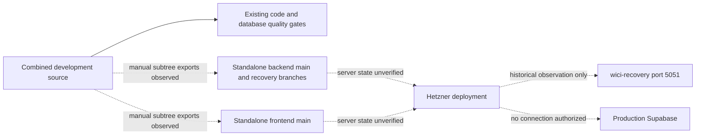

# Current-state audit — 9 November 2026 (Baghdad)

## Confirmed source-control facts

Read-only GitHub metadata/tree inspection returned the following. These are repository observations, not verification of the live server or database.

| Repository | Default branch / observed SHA | Protection reported | Checked-in workflows |
| --- | --- | --- | --- |
| purchase-tracker | master / 100c7407e3cd23a6d1e0cab569781c2d88d198a0 | false | release-quality.yml |
| purchase-backend | main / 70c4ee50bd0c8342eb30f573eacbd95f543a5e88 | false | none on main |
| purchase-frontend | main / 8a4ac51a52d30877c21e7300af9d4a1d5d410d6e | false | none on main |

All three repositories are public. The current GitHub identity reports administrative access; no settings or permissions were changed. The combined repository's environments API returned an empty list. Required reviewers and destination CI therefore cannot be assumed.

The combined application directories are ordinary tracked files: no tracked gitlinks, no .gitmodules, and no nested .git directory in either app in the inspected worktree. Existing separate Codex worktrees and unrelated uncommitted work were left intact. No repository restructuring is required or performed.

This implementation builds on reviewed combined-repository path/source-attestation commits through db877290, not on standalone recovery branches. That dependency is not yet on master and must be reviewed with this PR; do not overwrite independent recovery work to synchronize it.

Exact Git blob comparison against db877290 (before this infrastructure change) found:

| App | Combined files | Standalone main files | Identical | Changed | Combined only | Standalone only |
| --- | --- | --- | --- | --- | --- | --- |
| Backend | 949 | 933 | 919 | 14 | 16 | 0 |
| Frontend | 453 | 452 | 452 | 0 | 1 | 0 |

Standalone backend also contains recovery/wici-database-20261107 (2c2a4651), codex/pg17-release-diagnostics (1541dd72) and sync-from-purchase-tracker (718a6324). Standalone frontend has sync-from-purchase-tracker (c2a33cad) and independent feature/fix branches. These branches are not interchangeable with main. A default-branch tree comparison does not authorize discarding their work.

## Existing pipeline and integrity

The combined repository already provides scripts/quality/release.cjs, gates.json, policy tests, smoke-plan.json and release-quality.yml. Backend/frontend use npm ci; Node 22 is the quality baseline, with package engines permitting Node >=20. Backend has Jest API/auth/financial/workflow regressions and disposable PostgreSQL runners; frontend has React tests, lint, production build and localization checks. Database governance already checks registered source/SQL hashes, frozen history, dependency order, profiles, generated bundles, roles and attestations.

The original release workflow runs sixteen PostgreSQL suites on pull_request. Some invoke real migration fixtures. That conflicts with this assignment's prohibition on PR migration execution; move those suites to explicit isolated manual validation without removing them from full release readiness. Existing readiness evidence deliberately cannot authorize deployment.

Historical path defects used native path.relative results as manifest identities. The reviewed branch normalizes them to POSIX paths and passed thirty native Windows/Linux tests. Its authorized source digest and generated recovery-bundle binding were renewed without changing historical SQL. Current .gitattributes requires LF. Widespread mismatches in an external synchronization checkout have not been supplied as raw-byte evidence: CRLF is a hypothesis, not a confirmed cause. The new diagnostic will distinguish raw checksum, CRLF-equivalent, Git/worktree and stale-lock differences without accepting normalized bytes as valid.

No deploy/rollback/PM2/Nginx workflow or shell deployment mechanism was found in the tracked combined or standalone default-branch trees. This does not establish what exists on the server. Three tracked frontend .env variants contain no active uppercase assignments; .env.example documents a rollout flag. They still must be excluded from synchronization. The sole frontend source-only file is .env.example, so the managed frontend payload has no sync changes once environment files are excluded. Existing ignore rules cover dependencies and private uploads but need broader protection for local env/log/cache files.

## Environment names (never values)

Backend examples declare DATABASE_URL, JWT_SECRET, PORT, CORS_ALLOWED_ORIGINS, EMAIL_HOST/PORT/SECURE/USER/PASS/FROM, AI_PROVIDER/TIMEOUT_MS/MAX_TOOL_ITERATIONS/MAX_TOOL_RESULT_BYTES, OLLAMA_BASE_URL/MODEL, OPENAI_API_KEY/MODEL, SUPABASE_URL/SERVICE_ROLE_KEY/STORAGE_BUCKET/STORAGE_PREFIX, ATTACHMENT_LOCAL_FALLBACK_ENABLED, SCOP_FOUNDATION_ENABLED, GUIDED_REQUESTS_ENABLED and DB_RELEASE_SCHEMA_PROFILE. Governance also uses DB_RELEASE_READONLY_URL, DB_RUNTIME_ROLE and APP_RELEASE_REF. Frontend API configuration recognizes REACT_APP_API_BASE_URL, REACT_APP_API_BASE and REACT_APP_API_URL; its example declares REACT_APP_GUIDED_REQUESTS_ENABLED. Public frontend variables are never a secret store.

## Source-to-deployment architecture

## Risks, assumptions and missing approvals

Confirmed risks: unprotected default branches; absent destination CI; no configured approval environments; drift/independent recovery branches; source-bound governance sensitive to byte changes; PR migration jobs; frontend .env variants requiring export exclusions. Proposed authority is the combined repository, not an assertion that every standalone recovery change has been merged.

Unknowns: actual server branch/configuration, installed PostgreSQL version/extensions, current 2,210-finding restore reconciliation, live backups and recovery tests, staging target and DNS, sanitized fixtures, GitHub plan support for mandatory reviewers, final SAP integration authority and destination GitHub App installation. None was inferred from historical service details or inspected through server/production connectivity.

No production access, synchronization writes, infrastructure provisioning, migrations, branch protection changes or live-service modifications were performed during this audit. The historical recovery service remains outside automation's target set.
