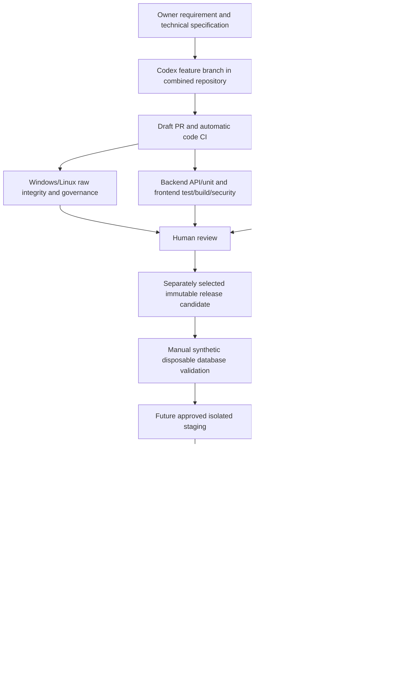

# Target architecture and ownership

`purchase-tracker` is the proposed development authority. Its application directories remain ordinary directories; no history, nested repository, working tree or standalone repository is deleted or rewritten. The path/source-attestation branch through db877290 is a dependency of this implementation.

Implemented now: automatic code CI, source integrity, deterministic sync plans, synthetic Git tests, disabled staging/production workflow templates and deployment checklists. No sync publisher, credential provisioning, staging target, image publishing, environment protection configuration or production executor is enabled. The manual disposable workflow is defined but was not dispatched during this assignment; all sixteen existing database suites remain necessary for full release readiness.

Code CI produces `CODE_TEST_READY`, not `TEST_READY` or deployment authority. The existing full quality manifest still requires its complete database gate evidence, source binding, build binding and actual CI outcomes; missing/failed/skipped gates block it. Its hosted compatibility and operational acceptance remain explicitly unverified. Do not relabel a code-only result as production acceptance.

## Repository ownership transition

1. Review/merge source-integrity dependencies and this infrastructure PR without rewriting history. Preserve local dirty work and all recovery branches/backups.
2. Review backend's fourteen changed and sixteen source-only files against standalone main, plus independent recovery/PG17 branches. Decide which fixes become canonical through ordinary reviewed PRs, not a bulk overwrite.
3. Confirm frontend's source-only difference and excluded environment files. Review `.gitattributes`/CI installation in each destination separately; neither currently has destination CI.
4. Configure branch protection and required checks on master/main, disallow direct pushes/force updates, require code owners, and verify plan support. This task did not change settings.
5. Establish accepted immutable source/destination baseline commit pairs only after content reconciliation. Keep those genuine decisions with review evidence; never invent a previous synchronization receipt.
6. Install a least-privilege GitHub App only after approval: selected destination repositories, Contents write and Pull requests write, no administration/actions/secrets permission. The current read-only planner needs none of these privileges.
7. Implement a publisher in a subsequent reviewed change, requiring no conflicts, explicit deletion review, source SHA/plan digest, destination head lease/check, destination CI and branch protection. It should commit on a new destination branch and open a PR; no force push or auto merge.
8. Keep standalone branches as deployment adapters until artifact-based deployment is approved. No reverse synchronization triggers; all source changes originate through combined review, including intentionally reconciled standalone fixes.

Automatic destination merge is not enabled: independent divergence, missing CI/protection and absent application installation make it unsafe. Staging and production remain disabled until separate target/credential/approval decisions are implemented and tested.
